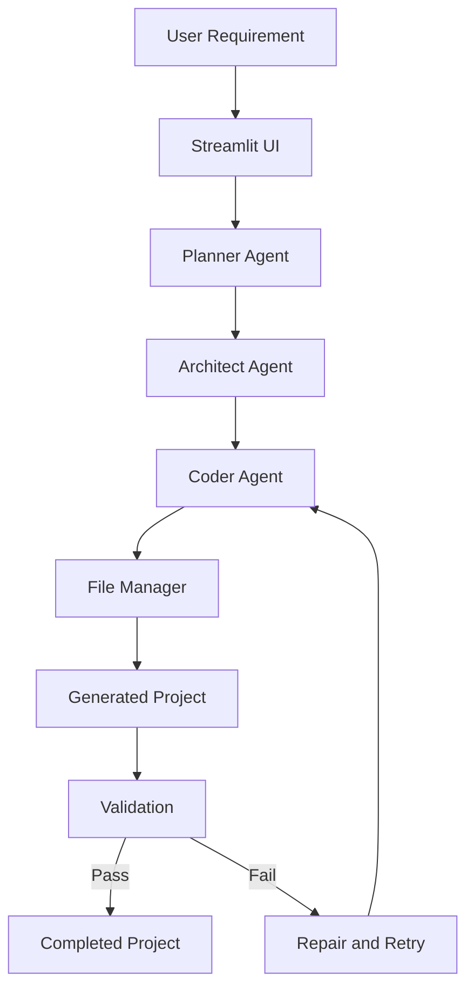

# NEXUS — Agentic Software Builder

**An AI-powered application builder that transforms natural-language requirements into project files through a multi-agent workflow.**

NEXUS is a Python-based Agentic AI project designed to automate parts of software development. It uses specialized AI agents to plan a solution, design its architecture, generate code, and validate the resulting project.

## ✨ Features

* **Planner Agent:** Breaks user requirements into an implementation plan.
* **Architect Agent:** Defines the proposed structure and technical design.
* **Coder Agent:** Generates source code and project files.
* **Automated File Generation:** Organizes generated code into project files.
* **Validation and Repair:** Checks generated output and attempts corrections when validation fails.
* **Retry Handling:** Supports repeated generation attempts for recoverable failures.
* **Interactive UI:** Provides a Streamlit interface for submitting requirements.
* **LLM Integration:** Uses the Groq API for language-model-powered generation.

## 🏗️ Architecture



## 🛠️ Tech Stack

* Python
* Streamlit
* Groq API
* Large Language Models (LLMs)
* Multi-agent workflow
* Git and GitHub

## 📁 Project Structure

```text
Agentic Software Builder/
├── agents/
│   ├── planner.py
│   ├── architect.py
│   └── coder.py
├── tools/
│   └── file_manager.py
├── generated_projects/
├── app.py
├── main.py
├── config.py
├── requirements.txt
├── .env.example
├── .gitignore
└── README.md
```

*The structure above is illustrative; adjust it to match the actual files in your repository.*

## ⚙️ Installation and Setup

### 1. Clone the repository

```bash
git clone https://github.com/erabdulhaja786-crypto/nexus-agentic-software-builder.git
cd nexus-agentic-software-builder
```

### 2. Create a virtual environment

```bash
python -m venv venv
```

Activate it on Windows PowerShell:

```powershell
.\venv\Scripts\Activate.ps1
```

### 3. Install dependencies

```bash
python -m pip install -r requirements.txt
```

### 4. Configure the API key

Create a `.env` file in the project root and add your own Groq API key using the environment variable name expected by the application.

Example, if the application uses `GROQ_API_KEY`:

```env
GROQ_API_KEY=your_groq_api_key_here
```

Never commit your actual `.env` file or expose API keys publicly.

### 5. Run the application

```bash
python -m streamlit run app.py
```

Open the local URL displayed in the terminal.

## 🚀 How It Works

1. The user submits a software requirement.
2. The Planner Agent prepares a plan.
3. The Architect Agent defines the solution structure.
4. The Coder Agent generates the necessary files.
5. The file manager writes the generated output.
6. Validation checks the output and may trigger repair attempts.
7. The user reviews the generated project.

## 🔐 Security

* Store API credentials in environment variables.
* Keep `.env` out of version control.
* Do not commit private credentials, personal data, or generated databases.
* Review generated code before running it, especially if it performs file operations or executes commands.

## 🎯 Project Goals

* Explore practical Agentic AI workflows.
* Apply role-based agent collaboration to software development.
* Automate repetitive project scaffolding tasks.
* Improve code-generation reliability through validation and repair.

## 👨‍💻 Author

**Abdul Rahman**

AI Engineer Aspirant

GitHub: [erabdulhaja786-crypto](https://github.com/erabdulhaja786-crypto)

---

*Built as an Agentic AI project exploring AI-assisted software development.*
